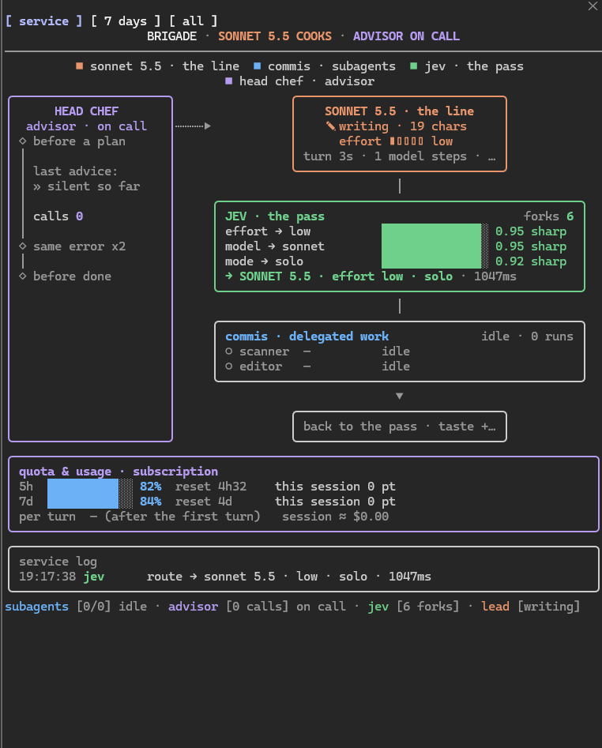
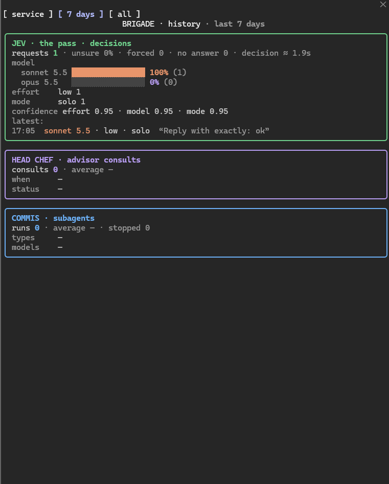

# Brigade

**The right model, effort and way of working for every request — quality first, savings and speed after.**

Brigade is a plugin for [Claude Code](https://claude.com/claude-code). Think of a kitchen: the *mise en place* is done before service so that service is fast and nothing is wasted. Before each request, a small fast model (Haiku, called **jev** here) decides how the request should be handled. A live pane then shows what the whole brigade is doing: the lead, the advisor, the subagents, your quota and the history.

> **Status: early and experimental.** It relies on Claude Code features that are still in early access (the plugin hooks API and the advisor tool), and the decision thresholds are starting values, not tuned ones. Read [Caveats](#caveats) before relying on it.

<p align="center">
  
</p>

## What it does

**1. A request router.** When you send a request, jev answers three questions in parallel, each with a confidence:

| Question | Options | What it changes |
| --- | --- | --- |
| How much effort does this need? | `low` … `max` | The effort of the lead's requests |
| Which model? | `sonnet` or `opus` | The model of the lead's requests |
| How should the work be organised? | `solo`, `delegate`, `team` | A short note the lead reads before starting |

**2. A live pane.** The lead's activity second by second, the advisor's checkpoints (*before a plan*, *same error x2*, *before done*), jev's decisions as confidence bars, one line per subagent, your remaining quota and what the session has used of it, turn by turn.

**3. A history.** Every routed request, advisor consult and subagent run is kept across sessions and summarised in the pane, so you can check whether the decisions were good.

## Who decides what

| Piece | Role | Decides |
| --- | --- | --- |
| **jev** (Haiku, this plugin) | Triage of each request | Effort, model, working mode — before the lead starts |
| **The lead** (Sonnet or Opus) | Does the work, orchestrates | When to consult the advisor, which subagent to launch |
| **The advisor** (Claude Code's own tool) | A stronger model that reads the whole session and gives advice | Nothing: it only advises, the lead decides |
| **Subagents** | Parts of the work, each with its own model and cache | Nothing: they report back to the lead |

Brigade never launches subagents or calls the advisor itself. It gives the lead a short note when it thinks one of them is warranted, and the lead decides.

## Requirements

- Claude Code **2.1.292** or later (developed and tested on that version).
- A Claude subscription or API key. The advisor tool is not available on Amazon Bedrock, Google Cloud's Agent Platform or Microsoft Foundry.
- To get the advisor in the pane: launch with an advisor, e.g. `claude --model claude-sonnet-5-5 --advisor claude-opus-5-5`. The `--advisor` flag is not listed in `claude --help`; the `/advisor` command and the `advisorModel` setting do the same.
- A wide terminal (144 columns or more) for the pane to open by itself. In a narrower one, type `/brigade`.

## Install

```
/plugin install brigade --marketplace ThomasGrim/brigade
```

Answer `y` to add the marketplace, pick a scope, then set the options (see below). Or try it from a clone without installing:

```
git clone https://github.com/ThomasGrim/brigade
claude --plugin-dir ./brigade
```

The setup the plugin was built around, as a one-line launcher (shell alias or `.bat` file):

```
claude --model claude-sonnet-5-5 --advisor claude-opus-5-5 --effort high
```

## Settings

Set when you install, or later in `/config`.

| Option | Default | What it does |
| --- | --- | --- |
| `routing` | `on` | `on`: jev picks effort, model and working mode for each request. `off`: the pane only observes and changes nothing. |
| `jevModel` | `haiku` | The model that answers the router's questions: an alias or a full model id. |
| `panel` | `auto` | `auto` opens the pane when a session starts; `command` opens it only on `/brigade`. |
| `retryConsult` | `false` | When a command fails twice in a row, ask jev "retry or stop?". The answer shows in the pane only. Off by default: it sends part of the error to jev (see [Privacy](#privacy)). |

## How the router decides

Quality first: going up takes little certainty, staying low takes more. Each "confidence" below is jev's confidence in its own choice, from 0 to 1 (for example, jev answers `opus` with 0.4: that is enough to switch to Opus).

| Decision | Rule |
| --- | --- |
| Model | `opus` is chosen from a confidence of **0.30**. Staying on Sonnet needs **0.60**. |
| Model, within a session | **Never goes down.** Each model has its own prompt cache, so a switch re-reads the whole conversation at full price. The tier resets when a new session starts, after a compaction, or after about an hour of idle time (when the cache is cold anyway). |
| Effort | Applied freely on every request: on Sonnet 5.5 and Opus 5.5 a change of effort keeps the cache. |
| Working mode | `team` needs **0.70** (it costs several contexts), `delegate` needs **0.50**. A `team` answered between 0.50 and 0.69 becomes `delegate`. Otherwise `solo`. |
| jev is unsure | The model stays as it is, the effort goes up one step, and the lead is asked to consult the advisor before it starts. |
| jev gives no answer in time (3 s) | Nothing changes. |
| You say otherwise | `#max` (Opus, max effort), `#fast` (Sonnet, low effort, solo), `#opus` or `#sonnet`, as the **first or last word** of your request. |

Things to know:

- Only requests running on Sonnet 5.5 or Opus 5.5 are routed. A model you picked with `/model`, a fallback model or Fable are left alone.
- With routing on, a `/effort` you typed is replaced on the next request. Use `#max` / `#fast`, or set `routing` to `off`.
- jev's note to the lead (for example "consult the advisor before you start") travels as hidden context beside your prompt: the model reads it, you do not see it in the conversation.
- The decision is made when you submit, and applies when the turn starts. A message typed while Claude is working does not change the model mid-turn.

## The pane

Open it with `/brigade`. Three faces, switched with the buttons at the top or with the keys **s**, **w** and **a** while the pane has focus:

- **s · service** — the diagram above, in real time.
- **w · 7 days** and **a · all** — the history: how often jev chose each model, effort and mode, how often it hesitated, how often you overrode it, its average confidence and decision time; the advisor's consults by moment, duration and status; subagent runs by type and model.

<p align="center">
  
</p>

The quota block shows what is left of each subscription window (5-hour, 7-day) and how many points this session has used, plus a bar per turn (purple when the advisor ran in that turn) and the session's estimated cost.

## Caveats

- **Advisor advice is not readable.** With a 5.x advisor (Opus 5.x, Sonnet 5.x, Fable) the API returns the advice encrypted: only the lead can read it. The pane shows *when* the advisor ran, for how long and with what status, not what it said. Claude Code itself shows only "Reviewed".
- **The advisor is not streamed.** The lead's response pauses while the advisor works and the advice arrives in one piece, so the pane can only infer a consult in progress from that pause (it is marked `consulting?`).
- **"Cost" is API pricing.** It is the same estimate `/cost` gives. On a subscription it measures how heavy a turn was, not what you are billed. The per-window "points used" come from the usage readings Claude Code exposes.
- **The share of cost "with advisor" includes the lead's own work** in those turns, because Claude Code does not report the advisor's tokens separately to plugins.
- **Thresholds are untuned.** jev's confidence comes from a general model and is only roughly calibrated. Watch the history pane for a while and tell me if the choices look off.
- **Early-access surface.** The plugin hooks API and the advisor tool may change between Claude Code releases.
- **Checked in the terminal only.** The screenshots come from Windows Terminal; the desktop app and IDE surfaces have not been tried yet. Screenshots and layout fixes are welcome.

## Privacy

- jev reads the request you submit (the first 1,500 characters), plus the size of your conversation, to answer its questions. It runs on **your own Claude login**, through your normal Claude Code session; nothing is sent to any other service.
- Only if you turn `retryConsult` on: when a command fails twice in a row, jev also receives the start of the command (about 40 characters) and up to 600 characters of the error message, at most 20 times per session. An error message can contain file paths or secrets, which is why this is off by default.
- The notes jev gives the lead mention subagents generically (a read-only one for searches, one per edit); the lead picks among the subagent types your session actually has.
- The history is stored locally by Claude Code, in the plugin's own storage on your machine. It keeps at most 500 decisions, 300 advisor consults and 300 subagent runs, and for each decision only the **first 70 characters** of your request. It is never uploaded by this plugin.

## Development

```
claude plugin validate .      # manifest, marketplace and hooks module
claude plugin test .          # the test suite (hooks/register.test.ts)
claude --plugin-dir .         # run it from this folder
```

The `claude-code` type declarations the editor needs are written by Claude Code the first time it loads the plugin, into `.claude-plugin/types/` (git-ignored). Load the plugin once (`claude --plugin-dir .`), then:

```
npx -p typescript tsc --noEmit -p .
```

Layout:

```
.claude-plugin/plugin.json        manifest and settings
.claude-plugin/marketplace.json   makes this repository installable
hooks/register.tsx                the plugin: router, pane, history
hooks/jev.ts                      jev's prompt
hooks/register.test.ts            tests
docs/                             screenshots
.github/workflows/ci.yml          type check on every push
CHANGELOG.md                      release notes
types/index.d.ts                  the plugin's saved-state contract
```

## License

[MIT](LICENSE) © ThomasGrim
